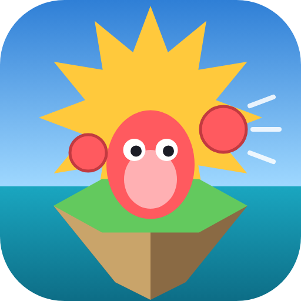

<h1 align="center">🏝️ Knockout Isles</h1>

A 20-player party brawler by <b>Ninebolt Studios</b>. Punch, dash and smash everyone off crumbling floating islands. Free in your browser on iPhone, iPad, Android and PC.

<b><a href="https://ninebolt-studios.github.io/Knockout-Isles/">▶ PLAY NOW</a></b>

- 📲 **App (iPhone/iPad):** https://ninebolt-studios.github.io/Knockout-Isles/KnockoutIsles.mobileconfig
- 🌐 **Ninebolt Studios:** https://ninebolt-studios.github.io/Ninebolt-Studios-Website/

## How to play
| | |
|---|---|
| 🏝️ **Goal** | Knock everyone off the island. **Last Isle Standing**: 1 life, last one wins. **KO Frenzy**: 2 minutes, respawns, most knockouts wins |
| 👊 **Punch** | Tap to jab (3-hit combo). **Hold** to charge a SMASH |
| 💨 **Dash** | Shove rivals, dodge, and dash again in mid-air to save yourself |
| 📈 **Damage %** | The higher your %, the further you fly |
| 🎁 **Crates** | 💣 bomb · 🍄 mega size · 👟 speed boots · 🛡️ shield · 🔨 hammer (3 smashes) |
| ⚠️ **Crumbling** | Red tiles are about to fall. Get to the middle! |

**Controls:** WASD / arrows to move, J / Space / click to punch, K / Shift to dash · Controller: stick, Ⓐ punch, Ⓑ dash · Touch: joystick + PUNCH + DASH

## Features
- 👥 **Up to 20 players**: quick play against bots, or host a room and share the 4-letter code (empty spots fill with bots)
- 🏝️ 3 islands: **Palm Cove**, **Magma Isle**, **Sky Reef**; the island grows with the number of players
- 🎩 Locker: 12 colours and 9 hats to unlock with coins
- ☁️ Accounts: same login as Ashfall and Boltrush, progress from every device is merged, nothing is ever lost
- ⚙️ Settings (sound, camera, touch button size, graphics, name tags, screen shake) and 🎁 gift codes
- 📲 Installs as an app, works offline against bots

## Updates
| Version | What's new |
|---|---|
| **v1** | First release: Last Isle Standing + KO Frenzy, 3 islands, up to 20 players online or vs bots, crates, hats, accounts, app |
